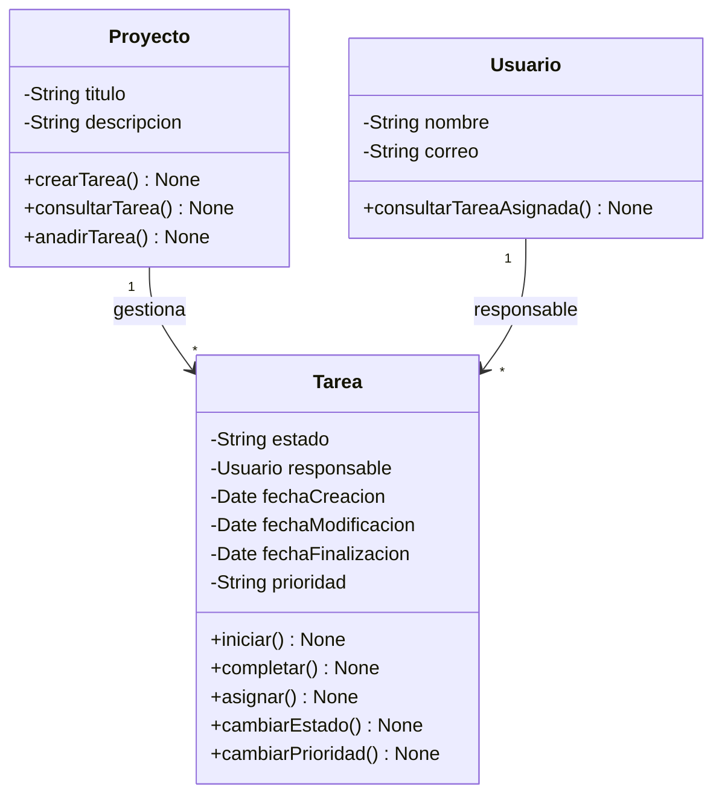

# Laboratorio 1
## Pensar antes de programar

Imagina que una pequeña empresa necesita una aplicación para organizar sus proyectos de desarrollo.
La aplicación debe permitir:
crear proyectos;
registrar usuarios;
crear tareas;
asignar tareas a usuarios;
cambiar el estado de una tarea;
Una tarea puede encontrarse en diferentes estados:
PENDIENTE → EN PROGRESO → COMPLETADA
Nuestro objetivo es únicamente diseñar el modelo de objetos y realizar una primera implementación en Python

## Parte 1. Analizar el problema

Antes de escribir código, identifica las entidades importantes del problema.
Completa una tabla como esta:

| Posible objeto | ¿Por qué existe?                                                                                     | ¿Qué información necesita?                              |
| -------------- | ---------------------------------------------------------------------------------------------------- | ------------------------------------------------------- |
| Proyecto       | Para organizar y crear las tareas del proyecto.                                                      | Nombre, descripción y lista de tareas.                  |
| Tarea          | Para representar las actividades que deben realizarse en cada proyecto.                              | Título, descripción, estado y usuario asignado.         |
| Usuario        | Para designar a las personas que trabajan en los proyectos y que desarrollaran las tareas asignadas. | Nombre, correo electrónico y lista de tareas asignadas. |

### ¿Qué otras entidades podrían existir?
Además de Proyecto, Tarea y Usuario, podemos identificar más entidades según las necesidades.

| Posible entidad | ¿Por qué podría existir?                                                                |
| --------------- | --------------------------------------------------------------------------------------- |
| Comentario      | Para que los usuarios puedan hacer comentarios, aclaraciones o avances sobre una tarea. |
| Prioridad       | Para indicar qué tareas son más urgentes.                                               |
| Notificación    | Para avisar a un usuario cuando se le asigna una tarea o cambia su estado.              |
| Fecha           | Indica cuándo se creó la tarea y las distintas modificaciones.                                                        |
| Historial       | Para registrar los cambios de estado de una tarea y quién los realizó.                  |

### ¿Cuáles son realmente necesarias?

Para la primera versión de la aplicación, considero necesarias estas tres entidades:
–Proyecto: permite organizar las actividades por proyectos.
–Usuario: permite registrar a las personas y asignarles tareas.
–Tarea: permite representar el trabajo pendiente, su responsable y su estado.
Con estas tres clases podemos cumplir todos los requisitos del enunciado.
Las demás entidades podrían ser opcionales. 
Por ejemplo, añadir Comentario por si los usuarios necesitan comunicarse dentro de cada tarea. o añadir prioridad para establecer la urgencia.

### ¿Cuáles son solamente datos o características de otras entidades?

-Comentario: normalmente sería una entidad independiente, porque puede tener contenido, autor y fecha de creación.
-Notificación: puede ser una entidad independiente si necesitamos guardar, consultar o marcar notificaciones como leídas.
-Historial: puede ser una entidad independiente si queremos registrar cada cambio de estado, quién lo realizó y cuándo.
-Fecha: puede ser un atributo de Tarea o de Historial, porque indicaría la fecha de creación, aunque podríamos crearla como un objeto, y determinar distintas fechas, de creación, actualizaciones, o terminación.
-Prioridad: puede ser un atributo de Tarea, porque solo indica el nivel de urgencia.

## Parte 2. Identificar el estado

### 1. PROYECTO.

-Nombre: para identificar el proyecto.  
-Descripción: para conocer qué se va a desarrollar.  
-Tareas: para saber qué tareas pertenecen al proyecto.  

### 2. USUARIO.

-Nombre: para identificar a la persona.  
-Correo electrónico: para distinguir a los usuarios y disponer de una forma de comunicacion.  
-Tareas asignadas: para conocer qué tareas tiene asignadas.  

### 3. TAREA.

-Título: para identificar el trabajo que se debe realizar.  
-Descripción: para explicar en qué consiste.  
-Estado: para saber si está pendiente, en progreso o completada.  
-Responsable: para conocer qué usuario tiene asignada la tarea.  

### 4. OTRAS ENTIDADES.

Se pueden incluir las entidades propuestas, sus estados podrían ser 

-**Comentario**: Contenido, autor y tarea relacionada.  
-**Notificación**: Mensaje, usuario destinatario y estado de lectura.  
-**Historial**: Tarea relacionada, estado anterior, estado nuevo y usuario que realizó el cambio.  
-**Prioridad**: No necesita ser una entidad. Puede ser un atributo de Tarea, pero solo sería necesaria si debe distinguir entre tareas más y menos urgentes.  
-**Fecha**: puede ser un atributo de Tarea, porque indicaria la fecha de creación, aunque podríamos crearla como un objeto, y determinar distintas fechas, de creación, actualizaciones, o terminación.  

## Parte 3. Identificar el comportamiento

Identificamos las acciones que puede realizar cada objeto de la aplicación.

**PROYECTO**  
Puede:  
-crear tareas  
-consultar sus tareas  
-eliminar tareas  

**USUARIO**  
Puede:  
-registrarse  
-consultar sus tareas asignadas  
-recibir tareas asignadas  

**TAREA**  
Puede:
-iniciar  
-completar  
-reasignarse  
-cambiar de estado  
-actualizar su descripción  

**COMENTARIO**  
Puede:  
-crearse  
-editarse  
-eliminarse  

**NOTIFICACIÓN**  
Puede:  
-enviarse  
-marcarse como leída  

**HISTORIAL**  
Puede:  
-registrar un cambio de estado  
-consultar los cambios realizados  

**PRIORIDAD**  
Si la prioridad es un atributo de Tarea, no necesita comportamientos propios. La tarea puede:  
-cambiar de prioridad  
-consultar su prioridad actual  

**FECHA**  
Si consideramos la fecha como un atributo de Tarea o Historial, sus comportamientos podrían ser:  
-registrar la fecha de creación  
-actualizar la fecha de modificación  
-registrar la fecha de finalización  
-consultar las fechas de la tarea  

## Parte 4. Responsabilidades

Cada acción debe ser responsabilidad del objeto que tiene la información y el control para realizarla.
Por ejemplo, completar una tarea debería ser responsabilidad de Tarea, porque es la propia tarea la que conoce su estado actual y debe actualizarlo.

| Acción                         | Objeto responsable | ¿Por qué?                                                                  |
| ------------------------------ | ------------------ | -------------------------------------------------------------------------- |
| Completar una tarea            | Tarea              | Porque conoce su estado y puede cambiarlo a COMPLETADA.                    |
| Iniciar una tarea              | Tarea              | Porque puede cambiar su estado de PENDIENTE a EN PROGRESO.                 |
| Asignar responsable            | Tarea              | Porque la tarea necesita conocer qué usuario es responsable de realizarla. |
| Crear proyecto                 | main.py            | Porque puede iniciar la aplicación y crear una instancia de Proyecto.      |
| Añadir una tarea al proyecto   | Proyecto           | Porque es el proyecto el que contiene y organiza sus tareas.               |
| Cambiar el estado de una tarea | Tarea              | Porque es responsable de mantener actualizado su propio estado.            |

-**Tarea**: gestiona sus propios cambios, su estado y su responsable.  
-**Usuario**: representa a la persona que realiza las tareas y permite consultar las tareas asignadas.  
-**Proyecto**: organiza las tareas que forman parte del proyecto.  
-**main.py**: crea objetos y solicita que se realicen acciones. No debería contener toda la lógica.  

## Parte 5. Diseñar el modelo

Reuniendo las decisiones anteriores: los objetos principales, sus atributos, sus comportamientos y las responsabilidades de cada clase.
1. Modelo conceptual

**PROYECTO**
Información(atributos)  
*nombre  
*descripción  
Comportamientos (métodos)  
+crear tareas()  
+añadir tareas()  
+consultar tareas()  
contiene una o varias tareas  

**TAREA**  
Información(atributos)  
*título  
*descripción  
*estado  
*responsable  
*fecha de creación  
*fecha de modificación  
*fecha de finalización  
*prioridad (opcional)  
Comportamientos (métodos)  
+iniciar()  
+completar()  
+cambiar estado()  
+asignar responsable()  
+actualizar descripción()  
+cambiar prioridad()  

**USUARIO**  
Información(atributos)  
*nombre  
*correo electrónico  
Comportamientos (métodos)  
+consultar tareas asignadas()  

2. Decisiones de diseño

-**Fecha**: será un atributo de Tarea. Si necesitamos registrar múltiples cambios, podremos añadir una clase Historial.  
-**Prioridad**: será un atributo opcional de Tarea, porque no es imprescindible para los requisitos iniciales.  
-**Comentarios y notificaciones**: se dejarán para una futura ampliación.  
**Responsabilidades**:  
cada clase gestiona las acciones de su función; main.py coordina la ejecución.  

## Parte 6. Diseñar las clases con UML

## Parte 7. Primera implementación con Python

## Parte 8. El historial de Git

Durante el laboratorio utiliza Git para registrar la evolución del proyecto.  
No esperes hasta el final.  
Realiza commits cuando completes partes significativas.  
Por ejemplo:  
git add .  
git commit -m "chore: crear proyecto TaskFlow"  
Después:  
git add .  
git commit -m "feat: crear clase Tarea"  
Y posteriormente:  
git add .  
git commit -m "feat: implementar comportamiento de Tarea"  
Finalmente:  
git push  
Consulta el historial:  
git log --oneline  
Tu repositorio debe permitir observar cómo ha evolucionado el diseño.  

## Parte 9. La IA como analista

En este laboratorio vamos a utilizar IA, pero no para que nos diseñe y programe TaskFlow.
Primero realiza tu propio análisis.
Después puedes utilizar una IA para contrastarlo.
Utiliza un prompt como:

Estoy diseñando una aplicación de gestión de proyectos llamada TaskFlow.
He identificado estos objetos:
- Proyecto
- Usuario
- Tarea

Para Tarea he considerado estos estados
Estar en distintos estados como pendiente, en progreso, completada,puede estar en distinta prioridad como baja, media, alta, también registra la fecha y hora de la creación de tareas y proyectos

Y estos comportamientos en el resto de clases:  
PROYECTO.-Puede: -crear tareas, -consultar sus tareas, -eliminar tareas, -añadir tareas  
USUARIO.-Puede: -registrarse, -consultar sus tareas asignadas, -recibir tareas asignadas  
TAREA.-Puede: -iniciar, -completar, asignarse, cambiar de estado, cambiar prioridad  

Sería interesante crear la clase historial para llevar un registro de la linea de tiempo ?

Analiza mi diseño como si fueras un analista de software.
No escribas código, cíñete a lo que te estoy preguntando o se lo pregunto a Microsoft Copilot, a claude o a gemini

Indica:
1. qué decisiones parecen coherentes;
2. qué responsabilidades podrían estar mal asignadas;
3. Sería interesante crear la clase historial para llevar un registro de la linea de tiempo?;
4. qué información podría faltar;
5. qué información podría sobrar;
6. qué preguntas debería hacerme antes de programar.

No rediseñes la solución completa, Si no sabes algo, no enredes. 

## RESPUESTA

Tu diseño de TaskFlow tiene una base coherente para una aplicación de gestión de proyectos. Has identificado tres entidades principales y has empezado a distinguir entre sus atributos y sus comportamientos, que es precisamente lo que conviene hacer antes de programar.
Voy a analizarlo desde el punto de vista del análisis orientado a objetos, sin rediseñar toda la solución ni introducir complejidad innecesaria.
### 1. ¿Qué decisiones parecen coherentes?
Hay varias decisiones bien encaminadas.  
**A. Separar Proyecto, Usuario y Tarea**    
Es una buena decisión porque representan conceptos diferentes del dominio:  
Proyecto: agrupa y organiza tareas.  
Usuario: representa a la persona que utiliza la aplicación y puede tener tareas asignadas.  
Tarea: representa una unidad de trabajo que tiene un estado, una prioridad y un responsable potencial.  
Las tres entidades tienen sentido y están relacionadas entre sí.  
**B. Los estados de Tarea**    
Los estados que has propuesto son coherentes:  
Pendiente.  
En progreso.  
Completada.  
Representan un ciclo de vida sencillo y suficiente para una primera versión.  
También es acertado que hayas separado el estado de la prioridad.  
Son dos conceptos diferentes:  
El estado indica en qué situación se encuentra una tarea.  
La prioridad indica qué importancia tiene o qué urgencia se le atribuye.  
Por tanto, una tarea puede estar pendiente y tener prioridad alta, por ejemplo.  
**C. Registrar fechas de creación**      
Es una buena decisión registrar cuándo se crean los proyectos y las tareas.  
Te permitirá conocer la antigüedad de los elementos, ordenar información cronológicamente y, posteriormente, calcular cuánto tiempo llevan abiertos.  
**D. Los comportamientos de Tarea**      
También son coherentes:  
Iniciar.  
Completar.  
Asignarse.  
Cambiar de estado.  
Cambiar prioridad.  
Son operaciones directamente relacionadas con el ciclo de vida de una tarea.  
Una observación: iniciar y completar son acciones que provocan un cambio de estado. Conviene que no se conviertan en dos mecanismos independientes de modificación del estado.  
### 2. ¿Qué responsabilidades podrían estar mal asignadas?  
Aquí hay algunos aspectos que revisaría.  

**Proyecto**  
Has indicado que puede:  
Crear tareas.  
Consultar sus tareas.  
Eliminar tareas.  
Añadir tareas.  
Hay una pequeña redundancia entre crear tareas y añadir tareas.  
No necesariamente significan lo mismo:
Crear una tarea implica generar una nueva tarea.
Añadir una tarea podría significar incorporar una tarea ya existente al proyecto.
Deberías decidir si tu aplicación contempla ambas operaciones.  
Por otro lado, Proyecto puede tener sentido como responsable de organizar sus tareas, pero no necesariamente de realizar todas las operaciones sobre ellas.  
Por ejemplo, cambiar la prioridad de una tarea es una responsabilidad que corresponde a Tarea, aunque Proyecto pueda facilitar esa operación.

**Usuario**
Has indicado que puede:  
Registrarse.  
Consultar sus tareas asignadas.  
Recibir tareas asignadas.  
Aquí distinguiría dos cuestiones.  
Registrarse: es una operación relacionada con la gestión de cuentas y usuarios. No es exactamente una responsabilidad del objeto Usuario una vez creado.  
Recibir tareas asignadas: la expresión es válida desde el punto de vista funcional, pero conviene distinguir entre recibir una asignación y almacenar la relación con una tarea.  
La asignación debería quedar reflejada en la relación entre Usuario y Tarea.  
Además, pregúntate si un usuario puede asignarse tareas a sí mismo o si únicamente otros usuarios pueden hacerlo.

**Tarea**
Es la clase donde veo las responsabilidades mejor definidas.  
Sus operaciones están relacionadas con su propio comportamiento.  
Una cuestión importante: ¿quién tiene permiso para ejecutar esas operaciones?  
Por ejemplo, ¿cualquier usuario puede completar cualquier tarea o solamente el usuario asignado?  
Esto afecta a las reglas de negocio, aunque no necesariamente a las responsabilidades de las clases.  

### 3. ¿Sería interesante crear la clase Historial?
Mi recomendación: sí, es interesante  
Considero que una clase Historial puede aportar valor a TaskFlow, especialmente porque quieres registrar una línea de tiempo.  
Pero hay una diferencia importante:
No es lo mismo conocer el estado actual de una tarea que conocer todo lo que le ha sucedido.
Imagina esta tarea:  
Tarea: Diseñar pantalla de inicio  
ESTADO ACTUAL  
Completada  
Historial de actividad  
Tarea creada  
30/10/2026 · 09:00  
Prioridad cambiada: Media → Alta  
30/10/2026 · 09:30  
Asignada a un usuario  
30/10/2026 · 10:00  
Estado cambiado: Pendiente → En progreso  
30/10/2026 · 11:00  
Estado cambiado: En progreso → Completada  
30/10/2026 · 13:00  
Observa que la tarea únicamente necesita conservar su estado actual para saber que está completada.  
Sin embargo, necesitas un registro adicional para conocer cómo ha llegado hasta ahí.  

**¿Qué responsabilidades tendría Historial?**  
Podría encargarse de:  
Registrar acontecimientos.  
Guardar la fecha y hora de cada acontecimiento.  
Identificar qué usuario realizó la acción.  
Identificar qué tarea se ha visto afectada.  
Conservar información sobre los cambios realizados.  

Por ejemplo, podrías registrar:   
Acontecimiento  
Información  
Creación  
Fecha de creación  
Cambio de estado  
Estado anterior y nuevo  
Cambio de prioridad  
Prioridad anterior y nueva  
Asignación  
Usuario anterior y nuevo  
Finalización  
Fecha y hora  

Mi recomendación: incorporaría Historial si quieres que TaskFlow tenga trazabilidad de las acciones.
No lo introduciría simplemente por tener más clases. Lo introduciría porque representa una necesidad funcional concreta.

### 4. ¿Qué información podría faltar?
Veo algunos datos que sería conveniente valorar.  
**En Proyecto**
Identificador único.  
Nombre del proyecto.  
Descripción.  
Fecha de creación.  
Fecha de modificación.  
Estado del proyecto, si necesitas distinguir entre activo, finalizado o archivado.  
**En Usuario**  
Identificador único.  
Nombre.  
Correo electrónico.  
Contraseña o mecanismo de autenticación.  
Fecha de registro.  
No necesitas necesariamente todos estos atributos desde el primer momento.  
**En Tarea**  
Identificador único.  
Título.  
Descripción.  
Estado.  
Prioridad.  
Fecha de creación.  
Fecha de modificación.  
Fecha de vencimiento, si existen plazos.  
Usuario asignado.  
Proyecto al que pertenece.  
Fecha de finalización.  
**Hay dos datos que considero especialmente interesantes:**  
Fecha de vencimiento: permite establecer cuándo debería terminar una tarea.  
Fecha de finalización: permite saber cuándo se terminó realmente, independientemente de cuándo se creó.  
También deberías decidir si una tarea puede estar sin asignar.  
**En Historial**  
Si finalmente incorporas esta clase:  
Identificador.  
Fecha y hora.  
Tipo de acontecimiento.  
Usuario que realizó la acción.  
Tarea afectada.  
Valor anterior.  
Valor nuevo.  
No todos los acontecimientos necesitan obligatoriamente valor anterior y nuevo. Por ejemplo, una creación no tiene un estado anterior.

### 5. ¿Qué información podría sobrar?
No veo atributos claramente innecesarios, pero sí algunos elementos que podrían generar redundancia.  
**A.** Crear tareas y añadir tareas  
Como comentaba anteriormente, debes aclarar si son dos operaciones distintas.  
**B.** Iniciar, completar y cambiar estado  
Podrías terminar teniendo tres operaciones que modifican el mismo atributo.  
No es incorrecto tenerlas, pero deben estar bien diferenciadas.  
Por ejemplo, iniciar y completar pueden ser acciones específicas que cambian el estado internamente.  
**C.** Fecha de creación y fecha de modificación  
No son redundantes.  
La fecha de creación nunca debería cambiar, mientras que la fecha de modificación se actualizaría cuando cambie la información de la entidad.  
**D.** Guardar demasiada información en Historial  
No necesitas duplicar toda la información de una tarea cada vez que se produzca un cambio.  
Historial debería registrar acontecimientos, no convertirse en una segunda copia de Proyecto, Usuario y Tarea.  

### 6. ¿Qué preguntas deberías hacerte antes de programar?
Esta es probablemente la parte más importante del análisis.
Te planteo preguntas que pueden ayudarte a detectar requisitos que todavía no has definido.
**Sobre Proyecto**  
¿Un proyecto puede tener varios usuarios?  
¿Un proyecto puede existir sin tareas?  
¿Una tarea puede pertenecer a varios proyectos?  
¿Se pueden archivar o eliminar proyectos?  
¿Quién puede crear o eliminar un proyecto?  
**Sobre Usuario**
¿Un usuario puede participar en varios proyectos?  
¿Un usuario puede tener varias tareas asignadas simultáneamente?  
¿Una tarea puede estar asignada a varios usuarios?  
¿Puede un usuario modificar tareas que no tiene asignadas?  
¿Existen distintos roles, como administrador y miembro?  
**Sobre Tarea**
¿Una tarea puede estar sin asignar?  
¿Se puede pasar directamente de pendiente a completada?  
¿Se puede reabrir una tarea completada?  
¿Una tarea puede tener fecha de vencimiento?  
¿Se puede eliminar una tarea después de completarla?  
¿Se puede cambiar la prioridad de una tarea completada?  
**Sobre Historial**
¿Quieres registrar todos los cambios o solamente los importantes?  
¿Quieres saber quién realizó cada cambio?  
¿El historial debe ser permanente o se puede eliminar?  
¿Quieres consultar el historial de una tarea individual o también el de un proyecto completo?  

## Valoración final como analista de software
Tu diseño tiene una base razonable. No veo necesario añadir muchas más clases en este momento.
Mi valoración sería la siguiente:

**Proyecto** -- Bien planteado  
**Usuario** -- Bien planteado, pero necesita aclarar responsabilidades  
**Tarea** -- Bien planteada  
**Estados** --- Coherentes  
**Prioridades** --- Coherentes  
**Fechas** --- Correcto, aunque faltan algunas por valorar  
**Historial** --- Interesante y justificado si necesitas trazabilidad  

### Hay tres cuestiones que resolvería antes de empezar a programar:
**Las relaciones:** determinar si un proyecto puede tener varios usuarios, si una tarea pertenece a un único proyecto y si puede tener varios responsables.
Las reglas de negocio: determinar qué cambios de estado están permitidos y quién puede realizarlos.  
**El historial:** decidir qué acontecimientos quieres conservar y para qué necesitas consultarlos.
Una última observación: no confundas las clases del dominio con las funcionalidades de la aplicación. Por ejemplo, registrarse, iniciar sesión o consultar tareas son funcionalidades; no tienen por qué convertirse automáticamente en responsabilidades de las entidades.  
**Mi consejo:** no añadas más clases todavía. Primero define las relaciones entre Proyecto, Usuario y Tarea, y aclara sus reglas de funcionamiento. Después podrás decidir con más seguridad qué otras clases necesita TaskFlow.  

## Entregables del laboratorio

taskflow/
└── src/
    └── taskflow/
        ├── __init__.py
        ├── main.py
        ├── tarea.py
        ├── usuario.py
        └── proyecto.py
└── doc/
    └── 01-analisis.md
    └── 02-modelo-uml.png
    └── 03-ia-prompt.md

## Aclaraciones
__init__.py
    ↓
"Este directorio forma parte de un paquete Python"

main.py
    ↓
"Desde aquí arranca nuestra aplicación"

tarea.py
    ↓
"Define la clase Tarea"

usuario.py
    ↓
"Define la clase Usuario"

proyecto.py
    ↓
"Define la clase Proyecto"

En main.py para hacer uso de Tarea y poder crear instancias, por ejemplo, tendríamos que hacer:

from taskflow.tarea import Tarea

def main() -> None:
    tarea = Tarea("Diseñar la página de inicio")

    print(tarea.titulo)

if __name__ == "__main__":
    main()

## ➕ Ampliación
Investiga cómo podríamos:

Listar las tareas de un responsable en concreto
Listar los proyectos y las tareas asociadas

